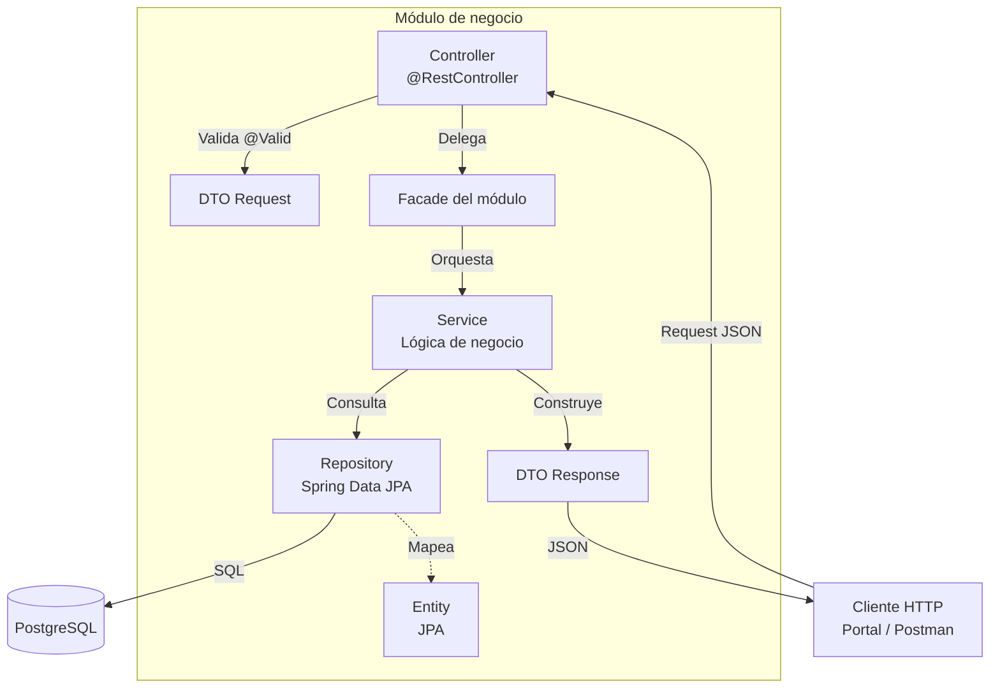

# Diagrama de Capas — Módulo típico

Cada módulo de negocio (`identity`, `members`, `plans`, `billing`, `attendance`, `training`) implementa la misma estructura interna de capas. El siguiente diagrama muestra el flujo de una petición HTTP a través de las capas.

| Capa | Responsabilidad | Clases típicas |
| :--- | :--- | :--- |
| **Controller** | Recibir peticiones HTTP, validar entrada, delegar al Facade. | `MemberController`, `PlanController`, `AuthController`[cite: 1] |
| **DTO** | Transportar datos entre capas y hacia el exterior. | `CreateMemberRequest`, `MemberDto`, `PlanDto`[cite: 1] |
| **Facade** | Punto de entrada del módulo para otros módulos. | `MembersFacade`, `PlansFacade`, `BillingFacade`, `IdentityFacade`, `AttendanceFacade`, `TrainingFacade`[cite: 1] |
| **Service** | Lógica de negocio y reglas de dominio. | `MemberService`, `PlanService`, `MembershipService`, `PaymentService`, `AttendanceService`, `RoutineService`[cite: 1] |
| **Repository** | Acceso a datos (interfaz de Spring Data JPA). | `MemberRepository`, `PlanRepository`, `PaymentRepository`[cite: 1] |
| **Entity** | Modelo persistente (tabla de base de datos). | `Member`, `Plan`, `Membership`, `Payment`, `User`[cite: 1] |

## Excepciones a la estructura
- reports no tiene entity ni repository: es un módulo de solo lectura que consulta a otros módulos vía Facades.

- platform solo contiene config (seguridad, CORS, OpenAPI) y errors (manejo global de excepciones). No sigue la estructura de capas porque es transversal.