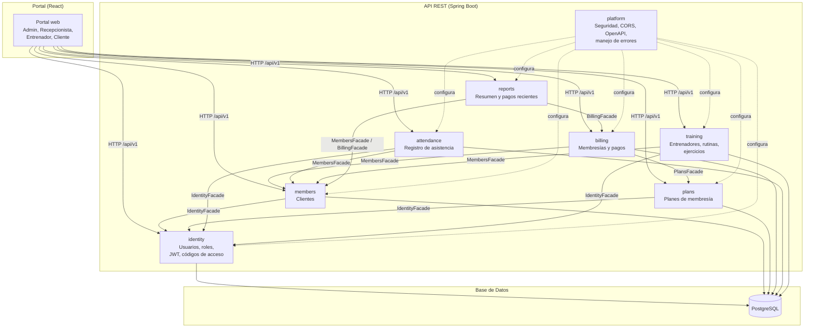

# Diagrama de Componentes — GMS

El siguiente diagrama muestra los módulos del backend y sus dependencias a través de Facades. Las flechas indican "consulta a través de".

## Reglas de dependencia
1. Ningún módulo accede directamente a entidades o repositorios de otro módulo. Solo a través de su Facade.

2. platform es transversal: configura seguridad, CORS, OpenAPI y manejo global de errores para todos los módulos.

3. reports es de solo lectura: consulta a otros módulos vía sus Facades, nunca escribe en sus tablas.

4. No hay claves foráneas entre tablas de distintos módulos. La integridad se valida en tiempo de escritura vía Facades.